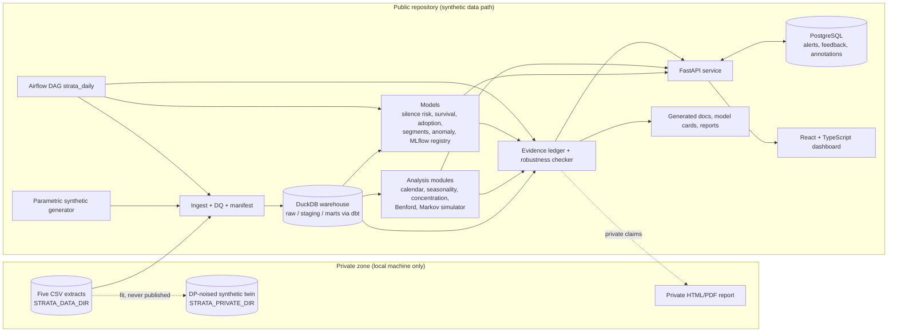

# Strata: architecture

Working name: **Strata**: the pipeline layers (raw, staging, marts), stratifies (the robustness
checker, the segments) and checks. Python package `strata`, CLI `strata`, environment variables `STRATA_*`.
The GitHub repository keeps its current name because CVs link to it.

Status: architecture v1, written 2026-10-18 by the architect session (Fable). The executing agent
builds against this document and `MILESTONES.md`, under `AGENT_RULES.md`. Deviations are allowed only
through an ADR in `docs/adr/`.

## 1. What this is

A research-grade behaviour-analytics **pipeline** for multi-channel retail-banking event data. The
product is the pipeline: contracts, warehouse, evidence ledger, robustness checks, calendar and
channel models, time-validated risk models, an anomaly layer, serving, orchestration and a dashboard.
Its reference instance is a twelve-month anonymised extract of 1,000 clients (card transactions,
online operations, branch operations, a client table, and a second, pre-aggregated sample of 1,000
other clients), but any source with clients and dated channel events plugs in through a mapping file
(§5.0), and the synthetic generator is a first-class source. It replaces a 2024 hackathon script.

It is **a whole system, not a notebook**: a typed data warehouse, an evidence ledger where no number
in any document is typed by hand, a robustness checker that re-stratifies every headline finding, a
Bayesian calendar model, a channel-migration simulator, time-validated risk models, an anomaly layer
with a review queue, a served API, an orchestrated DAG, and a dashboard. The public repository runs
end to end on synthetic data. The real findings are produced locally and stay private.

The framing is general (any retail bank with these channels), with CIH Bank named as the source of
the reference extract. Findings are a by-product that demonstrates the pipeline; the pipeline is
what is being built and judged.

## 2. Principles

1. **No number is typed by hand.** Every figure in docs, README, dashboard and reports comes from the
   evidence ledger, with its sample size, confidence interval, method and data fingerprint.
2. **Privacy boundary is structural, not a habit.** Real data is read only through `STRATA_DATA_DIR`.
   Nothing derived from real rows enters the repository except allow-listed aggregate claims.
   A pre-commit guard enforces it. See section 6.
3. **Every finding carries its uncertainty and its stratified check.** A headline that reverses under
   stratification is reported as reversing. That is a feature of the system, not an embarrassment.
4. **Time is respected.** Features come from an observation window, labels from a later outcome window.
   No random splits on client-level outcomes. Rolling-origin backtests for stability.
5. **Synthetic first.** The parametric generator reproduces the schema and the quirks of the extract
   so that tests, CI, the demo and the dashboard never need real data.
6. **Boring, typed, tested engineering.** Python 3.12 via `uv`, ruff, mypy, pytest + hypothesis,
   pandera contracts, dbt tests, Alembic migrations, conventional commits, ADRs.
7. **Models are compared against honest baselines** (majority class, logistic GLM, naive seasonal) and
   reported with calibration, not just discrimination.
8. **Decision-relevant outputs.** Each module ends in something a bank team could act on: a ranked
   list, a what-if band, an alert queue with reasons, a calendar of effects.

## 3. System context and containers (C4)



Runtime containers (Docker Compose): `api`, `dashboard`, `postgres`, `airflow` (webserver, scheduler,
its own metadata Postgres), `mlflow` (optional, file store). DuckDB is a file, mounted read-only into
`api`.

## 4. Repository layout

```
.
├── ARCHITECTURE.md  AGENT_RULES.md  MILESTONES.md  PROGRESS.md  PRIVACY.md  CHANGELOG.md
├── pyproject.toml  uv.lock  justfile  .pre-commit-config.yaml  .python-version (3.12)
├── strata/                         # Python package (typed, tested)
│   ├── config.py                  # pydantic-settings: STRATA_DATA_DIR, STRATA_PRIVATE_DIR, STRATA_DB, ...
│   ├── cli.py                     # typer: strata synth | ingest | dq | dbt | ledger | analyse | train | report | serve
│   ├── contracts/                 # pandera schemas for the five extracts and the marts
│   ├── ingest/                    # loaders, manifest (hashes, counts, date ranges), reconciliation checks
│   ├── synthetic/
│   │   ├── parametric.py          # PUBLIC generator: hand-specified distributions + quirks, seeded
│   │   └── twin.py                # PRIVATE generator: copula fitted on real marginals + DP noise; metrics
│   ├── ledger/                    # claim registry, build/render/check, allowlist, robustness checker
│   ├── analysis/                  # calendar, seasonality, concentration, benford, markov
│   ├── models/                    # splits, churn, survival, adoption, segments, anomaly, registry
│   ├── report/                    # Jinja2 + Plotly HTML report (public/private variants)
│   └── privacy_guard.py           # pre-commit scanner for identifiers and extract signatures
├── dbt/                           # dbt-duckdb project: staging, intermediate, marts, seeds, tests
├── services/api/                  # FastAPI app, SQLAlchemy models, Alembic migrations
├── orchestration/airflow/dags/    # strata_daily.py
├── apps/dashboard/                # React 19 + TypeScript + Vite + TanStack Query + ECharts + Tailwind
├── docs/
│   ├── adr/                       # architecture decision records
│   ├── ledger/claims.public.json  # the only real-data numbers in the repo (allow-listed aggregates)
│   ├── findings/*.md.j2 -> *.md   # rendered from the ledger; never hand-edited
│   ├── methods/                   # equations (KaTeX in dashboard, LaTeX in docs)
│   ├── model_cards/  data_card.md  c4/
│   └── CV_NOTES.md                # bullet drafts, every number traced to a claim id
├── legacy/                        # the 2024 script and the 2025 package, frozen, with a README of their bugs
├── tests/                         # pytest + hypothesis; everything runs on synthetic data
├── .github/workflows/ci.yml
└── docker-compose.yml  Dockerfile.api  Dockerfile.dashboard
```

## 5. Data plane

### 5.0 Canonical event model and source mappings

The pipeline is source-agnostic from the raw layer upward. Every source is described by a mapping
file (`mappings/<source>.yaml`: file names or globs, encoding, delimiter, date formats, column
renames, code maps or seed references, and which file plays which role) that `strata ingest
--mapping <file>` uses to load the source into the canonical raw tables: `raw.clients`
(client_id, attributes), `raw.events` (client_id, ts, channel, kind, amount, direction, origin,
source_file, source_row) and the optional `raw.client_aggregates`. dbt staging reads only the
canonical tables, so every mart, claim and model works unchanged on a new source. Two mappings
ship: `reference_cih.yaml` (the five extracts, reproducing the behaviour of the typed contracts
built in M1) and `synthetic.yaml` (the generator's output). A portability test builds a third,
deliberately different schema with hypothesis and proves the marts are identical after mapping.
This layer is introduced as milestone M4.5 as a thin layer over the existing contracts.

### 5.1 The reference extract (facts measured on 2026-10-18)

All files are comma-separated, `latin-1` encoded, dates as `YYYY-MM-DDTHH:MM` with the time always
`00:00` (no time of day anywhere). Window: 2023-10-02 to 2024-10-02 (a rolling year; the last
two days of October 2024 are a stub). Identifiers are opaque strings.

| File | Rows | Grain | Columns |
|---|---|---|---|
| `echantillons_clients(in).csv` | 1,000 | one per client | identifiant_client, anciennete_client (years, 2–34), age (20–99), genre (1/2), situation_familiale (4 codes), nombre_d_enfants, secteur_professionnel (38 codes, 47% null), profession (42 codes, 47% null), categorie_socio_professionelle (16 codes, 47% null) |
| `transactions_monetiques_annee_glissante_anonymise(in).csv` | 33,149 | one per card transaction | identifiant_client (733 clients), date_transaction, montant_local (0.01–40,000 MAD), libelle_nature_transaction (7 values: PURCHASES & SERVICES, ACHATS E COMMERCE, WITHDRAWAL, Deposit, Refund, VISA MONEY TRANSFERT LOAD, MastercardMoney Send), type_origine (National/International) |
| `operations_en_ligne_annee_glissante_anonymise(in).csv` | 18,507 | one per online operation | identifiant_client (575 clients), service (6 values: bill pay/telecom recharge/vignette 87%, card operations, e-shopping recharge, Cash Express transfer, card debit, Binatna recharge), operation_date_time, montant_transaction (0–48,250) |
| `operations_en_agence_annee_glissante_anonymise(in).csv` | 4,231 | one per branch operation | identifiant_client (655 clients), date_operation, montant_operation (3–600,000), sens_operation (C 84% / D 16%), operation (24 labels; VERSEMENT SUR COMPTE is 82%), devise (MAD only) |
| `al_akhawayn_dataset_v2(in).csv` | 2,000 rows, 1,000 non-empty | one per client, **a different sample**: its identifiers match none of the client file | 60 pre-aggregated columns: demographics, flags, per-service yearly counts, amount statistics (mean/std/median/min/max), months since first/last operation and transaction, credit flags, card-usage counts by merchant type |

Join coverage against the client file: card 733, online 575, branch 655; 947 clients have any
activity, 342 have all three channels, 53 have none. Median card transactions per active card client
is 20 (p90 117, max 725).

Observed code semantics (to be confirmed in a seed table, never assumed silently): in the aggregate
file `civilite` is 0/1; `client_has_cih_online` and `flag_contrat_actif` are coded 1/2 where 1 means
yes (clients coded 2 have zero operations); `a_email` is the strings True/False;
`transaction_international` is 0/1; `flag_debit_credit` takes -1/0/1/2 (unknown meaning, keep as
category). Two column names contain `ç` (`commerçant`): rename in staging.

Quirks the synthetic generator must reproduce (rates are in the private findings note): a few
percent of card rows are exact repeats (same client, date, amount, category, origin) that cannot be
told from double posting because there is no transaction id or time of day; every zero-amount
online row is a card-service operation; a handful of card transactions are under 1 MAD; branch
amounts are heavy-tailed; withdrawals are almost all multiples of 100; card deposits surge in
December; the first days of the month carry more withdrawals; e-commerce purchases are mostly
international and small.

### 5.2 Warehouse

DuckDB file at `STRATA_DB` (default `.strata/strata.duckdb`, gitignored). Schemas:

- `raw.*`: the five files as loaded, plus `raw.manifest` (file name, sha256, rows, columns, date
  range, loaded_at) and `raw.dq_report` (check id, severity, count, sample-free description).
- dbt (`dbt/`, adapter `dbt-duckdb`):
  - `staging`: typed, English column names, codes mapped through seeds (`codes_*.csv`), dedup flag
    kept as a column, never dropped silently.
  - `intermediate`: `int_events` (union of the three channels: client_id, ts, channel, kind,
    amount, direction, origin, is_zero_amount, is_repeat), `int_client_month` (per client-month
    counts and amounts per channel, with window functions for recency and rolling sums),
    `int_channel_state` (per client-month state: none / branch_only / digital_only / mixed).
  - `marts`: `client_360`, `features_silence` (parameterised by cutoff date), `features_segments`,
    `features_anomaly`, `daily_counts` (per channel and category, with calendar columns), `aggregate_clients`.
  - dbt tests: unique, not_null, accepted_values, relationships, plus custom tests (no event outside
    the window, amounts non-negative, state partition sums to client count).

### 5.3 Synthetic data

- **Parametric (public)**: `strata synth --out <dir> --clients 1000 --seed 42` writes the five files
  with the real names, encodings and date format. Distributions are hand-specified in one module
  (`synthetic/parametric.py`) with comments explaining each choice. Hypothesis tests assert
  invariants: schema equality with the contracts, the quirk rates within tolerance, join coverage
  within the observed ranges, deterministic output for a seed.
- **Twin (private)**: `strata synth-twin --data-dir $STRATA_DATA_DIR --out $STRATA_PRIVATE_DIR/twin
  --epsilon 1.0`: Gaussian copula fitted on real marginals with Laplace noise added to each marginal
  histogram (budget `epsilon`), sampled at 1,000 clients. Reports fidelity (per-column KS, correlation
  matrix distance, propensity-score AUC with a classifier that tries to tell real from synthetic) and
  privacy (nearest-neighbour distance ratio, membership-inference AUC). Output paths must be under
  `STRATA_PRIVATE_DIR`; a test asserts the writer refuses any path inside the repository.

## 6. The privacy boundary

- Real data: read only via `strata.config.Settings.data_dir` (`STRATA_DATA_DIR`). No module may
  hard-code the private path. The loaders raise if the path is inside the repository.
- Private outputs (twin, private claims, private report, trained models fitted on real data) go to
  `STRATA_PRIVATE_DIR` (the value for this machine is in the gitignored `.env.local`; there is no
  default inside the repository), never into the repo.
- The only real-data numbers allowed in the repository are claims listed in
  `strata/ledger/allowlist.py` (initial list: `channel_mix`, `age_digital_divide`, `weekday_pattern`,
  `benford_purchases`), each with n ≥ 50 and no identifiers, written to `docs/ledger/claims.public.json`.
- `strata/privacy_guard.py` runs as a pre-commit hook on staged files: it blocks any file whose header
  matches one of the five extracts, any CSV with more than 200 rows outside `tests/fixtures/`, any
  identifier-like token pattern learned from the extracts' id format (regex derived at run time from
  `STRATA_DATA_DIR` if present, falling back to a conservative pattern), and any JSON under
  `docs/ledger/` whose claim ids are not in the allowlist.
- Logs never print identifiers. `structlog` processors redact any field named `client_id`.
- `PRIVACY.md` documents all of the above for readers.

## 7. The evidence ledger

- `strata.ledger.claim` decorator registers a function `(warehouse) -> ClaimResult`. A claim has:
  `id`, `title`, `question`, `method`, `values: dict[str, float]`, `n: int`,
  `ci: dict[str, tuple[float, float]]` (bootstrap, 1,000 resamples by client), `caveats: list[str]`,
  `headline: bool`, `group_col`/`metric` (for the robustness checker), `public: bool`.
- `strata ledger build --data-dir … --out docs/ledger/claims.private.json` (gitignored) and
  `--public` to write only allow-listed claims to `docs/ledger/claims.public.json`. Each JSON record
  carries `data_fingerprint` (sha256 of the manifest) and `computed_at`.
- Docs are templates: `docs/findings/*.md.j2` with `{{ ledger("age_digital_divide", "branch_only_65plus") }}`
  and `{{ ci("age_digital_divide", "branch_only_65plus") }}`. `strata ledger render` produces the
  `.md`. Rendered files carry a header "generated, do not edit".
- `strata ledger check` (CI): re-renders and fails on any diff; fails if a tracked `.md` under
  `docs/findings/` or the README's ledger-governed sections (between `<!-- ledger:start -->` and
  `<!-- ledger:end -->`) contain a number (regex) that does not map to a rendered placeholder; fails if
  `claims.public.json` contains a non-allow-listed id. On CI the claim functions themselves run on
  synthetic data to prove they execute.
- The dashboard's Findings page and the report read the same JSON.

## 8. The robustness checker (Simpson guard)

For each claim with `headline=True`, recompute the effect (difference of the metric between groups
defined by `group_col`) overall and within strata of activity tercile, age band and tenure band.
Report per stratum effect with CI, `sign_flips`, `shrinkage = 1 - min_stratum_effect / overall_effect`,
and a verdict: `holds` (same sign in every stratum, shrinkage < 0.5), `weakens`, `reverses`.
The verdict is stored in the claim record, rendered as a badge in docs and dashboard, and the
private report lists every headline with its verdict. The silence-by-channel finding is the
canonical example: it reverses once activity level is controlled (branch-only clients simply have
far fewer events than digital-only clients).

## 9. Analysis modules

- `calendar`: daily counts per channel and category. (a) Frequentist: negative-binomial GLM
  (statsmodels) with day-of-week, day-of-month bins (1–5, 6–10, …), month, trend, Ramadan 2024
  (11 Mar–9 Apr), Eid al-Fitr (10–11 Apr), Eid al-Adha (16–17 Jun) and the week before it, with
  bootstrap CIs on effects. (b) Bayesian: the same model in PyMC with weakly informative priors,
  posterior predictive checks and posterior probabilities such as P(December deposit effect > 2×).
  Install order: PyMC on Python 3.12; if it does not install cleanly within thirty minutes, use
  NumPyro; if that fails, a Laplace approximation of the GLM. Record the choice in ADR 0007.
- `seasonality`: STL per series; the December deposit wave decomposed into breadth (clients) and
  depth (amount per client); the pre-Eid branch deposit week; Ramadan null result.
- `concentration`: Lorenz curve, Gini with bootstrap CI, top-k shares, RFM scores per channel.
- `benford`: first-digit and first-two-digit tests per category with chi-square and Nigrini MAD
  conformity bands; the digit-9 excess in purchases documented as psychological pricing.
- `markov`: client-month channel states; transition counts; Dirichlet(1) posterior per row;
  2,000 posterior samples; stationary distribution and mean first-passage times with CIs;
  `simulate(policy, horizon=12)` where a policy moves a share `p` of `branch_only` clients matching a
  filter (for example age < 45) to `mixed` at month 0; outputs 5–95% bands for branch operation load,
  digital share and silent share. Served by the API and driven by sliders in the dashboard.

## 10. Modelling modules

- `splits`: observation window 2023-10-02 to 2024-06-30, outcome window 2024-07-01 to 2024-09-29.
  Universe: clients with ≥ 1 event in the observation window. Label `silent` = zero events in the
  outcome window. Rolling-origin backtests with cutoffs 2024-04-30, 2024-05-31, 2024-06-30, each
  with a three-month outcome window. No feature may use data after its cutoff (a test asserts it).
- `churn` (silence risk): baselines (majority, activity-rate rule), logistic GLM with odds ratios and
  CIs, LightGBM tuned with Optuna on the earliest cutoff only, calibration (isotonic and Platt;
  Brier, ECE, reliability plot), SHAP global and local, lift and precision at 10%, bootstrap CIs on
  every metric, a comparison table and a model card.
- `survival`: recurrent-event gaps per client; Kaplan–Meier of time to next event by channel profile
  and age band with log-rank tests; Cox PH with cluster-robust SEs by client and a proportional-hazards
  check; also time-to-silence with censoring at the window end.
- `adoption`: on the aggregate file (the other 1,000 clients): targets `has_online` (code 1) and
  `active_online` (≥ 12 online operations in the year); logistic GLM with odds ratios, LightGBM, lift
  and gain charts, decile table; model card. Age and email are expected to dominate; say so.
- `segments`: features from `client_360` (per-channel RFM, channel shares, international share,
  deposit intensity, e-commerce share, card-service operations, round-amount share), log1p and
  standardise; Gaussian mixtures selected by BIC (k = 2..10), KMeans with silhouette, UMAP 2D for
  display; bootstrap ARI stability over 50 resamples; profile tables with chi-square and
  Kruskal–Wallis tests; automatic segment naming from the two most distinctive features.
- `anomaly`: a rules engine configured in `strata/models/anomaly/rules.yaml` (large cash deposit ≥ T,
  deposit velocity ≥ k in 30 days, structuring: ≥ 3 deposits each below T summing ≥ T within 30 days,
  pass-through: deposit ≥ X followed by a branch withdrawal within 7 days, dormant-then-burst,
  cash-intensive: branch deposits ≥ 5× card spend); Isolation Forest on `features_anomaly`; per-category
  log-normal amount models per client with empirical-Bayes shrinkage toward the category prior
  (robust z on log amounts); Benford per high-volume client. Combined score with reasons; precision
  at k against pseudo-labels (flagged by ≥ 2 independent rules) and against analyst feedback stored
  in Postgres; an alert-budget selector. Explicitly framed as triage, never as accusation.
- `registry`: MLflow (file store under `.strata/mlruns`, gitignored) with params, metrics, artefacts,
  and a `promote` command that writes `models/registry.json` (public, synthetic-trained models only).

## 11. Serving

FastAPI (`services/api`), Pydantic v2, SQLAlchemy 2 + Alembic for Postgres (SQLite fallback via
`STRATA_PG_URL`), DuckDB read-only connection per request, structlog, Prometheus metrics at
`/metrics`, OpenAPI docs, optional API key middleware.

| Endpoint | Returns |
|---|---|
| `GET /health` | versions, data fingerprint, model versions |
| `GET /clients/{id}/360` | profile, channel timeline, segment, silence risk with top SHAP reasons, open alerts |
| `GET /segments` | segment list with profiles and stability |
| `GET /risk/silence?top=k` | ranked clients with calibrated probability and reasons |
| `GET /adoption/deciles` | decile table with lift |
| `GET /alerts?budget=k` | ranked alerts with rule evidence; `POST /alerts/{id}/feedback` stores analyst labels |
| `GET /calendar/effects` | effect table with CIs from both models |
| `POST /markov/simulate` | bands for a policy |
| `GET /ledger/claims` | public claims with CIs and robustness verdicts |

## 12. Orchestration

`orchestration/airflow/dags/strata_daily.py`: ingest → dq → dbt run → dbt test → features → train
(churn, adoption, segments, anomaly) → evaluate → ledger build → report. Tasks call the `strata` CLI.
Runs in Compose on synthetic data; locally it can point at the private directory. Tested with
`airflow dags test`.

## 13. Dashboard

`apps/dashboard`: React 19, TypeScript strict, Vite, TanStack Query, ECharts, Tailwind, Radix
primitives, KaTeX, pnpm, Vitest, Storybook, Playwright smoke tests, axe accessibility checks.
Pages: Overview (KPIs, channel mix, calendar heatmap), Findings (ledger cards with CI and robustness
badges), Customer 360, Segments (UMAP scatter and profiles), Risk (ranked list, calibration, lift),
Adoption (deciles), Alerts (queue with reasons and feedback), Simulator (Markov what-if with sliders
and bands), Methods (equations). Design tokens, light and dark themes, responsive to phone width.
Runs against the API on synthetic data; no real-data numbers are bundled except the public claims JSON.

## 14. Reports

`strata report --variant public|private`: Jinja2 + Plotly HTML (PDF via WeasyPrint if available).
The private variant renders every claim and goes to `STRATA_PRIVATE_DIR`; the public variant renders
only allow-listed claims and the synthetic demo.

## 15. Quality and developer experience

`uv` with `.python-version` 3.12 and `uv.lock`; `ruff` (format + lint), `mypy` (strict on `strata`),
`pytest` with `hypothesis`, coverage gate 85% on `strata`; `pre-commit` (ruff, mypy, privacy guard,
nbstripout); `justfile` recipes: `setup`, `synth`, `ingest`, `dbt`, `ledger`, `train`, `report`,
`api`, `dashboard`, `check`, `demo` (one command: synth → ingest → dbt → ledger → train → report →
compose up); GitHub Actions: lint, type, unit, dbt tests on synthetic, ledger check, dashboard build
and tests, Docker build; `CHANGELOG.md` (Keep a Changelog); ADRs; C4 diagrams in Mermaid; model
cards; data card.

## 16. Candidate findings (pointer only)

The architect's first-pass findings live outside the repository, in `architect_findings.md` under
`STRATA_PRIVATE_DIR`. They are hypotheses until they are ledger claims with CIs and robustness
verdicts, and only allow-listed claims may ever appear in tracked files. Qualitatively, the claims to
implement in M3 and M4 cover: the channel mix and its relation to age and tenure; the concentration
of the online channel on bill payment; branches as cash-in points; a year-end wave of card deposits;
start-of-month withdrawals; the international share of e-commerce; concentration of card spend;
a Benford deviation in purchase amounts; cash-deposit patterns suitable for triage; repeat rows that
cannot be classified without a transaction id; the non-joining aggregate file; a headline retention
finding that reverses under stratification; and calendar effects around Ramadan and the Eids.

The findings are a by-product that demonstrates the pipeline. The pipeline is what is being built
and judged.

## 17. The legacy code and its bugs (state them openly in `legacy/README.md` and the changelog)

SMOTE applied before the train/test split (inflated accuracy); the merge with the aggregate file
matched zero rows and silently produced empty columns; recency computed from the run date instead of
the extract date; the target was each client's most frequent transaction type, a weak question;
no time-based validation; no uncertainty reported.

## 18. Glossary

Silence: no events in the outcome window. Channel state: none / branch_only / digital_only / mixed per
client-month. Claim: a registered, reproducible number with CI. Robustness verdict: holds / weakens /
reverses. Twin: private DP-noised synthetic copy. Parametric synthetic: public hand-specified generator.
