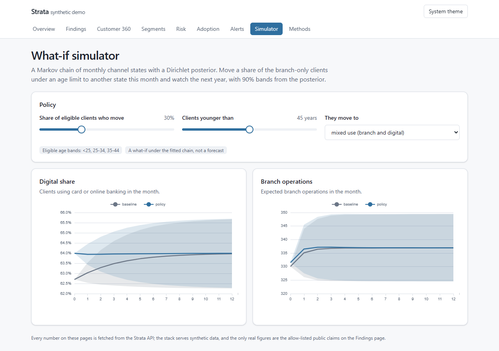
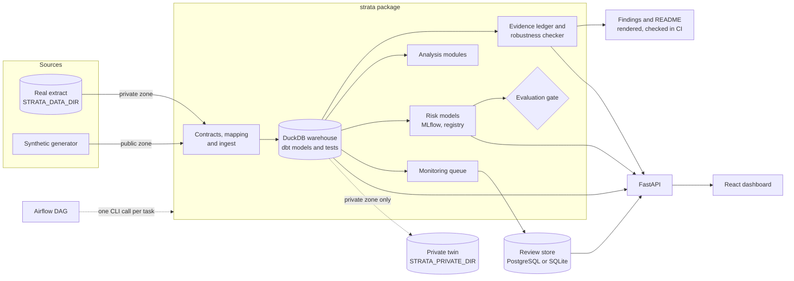
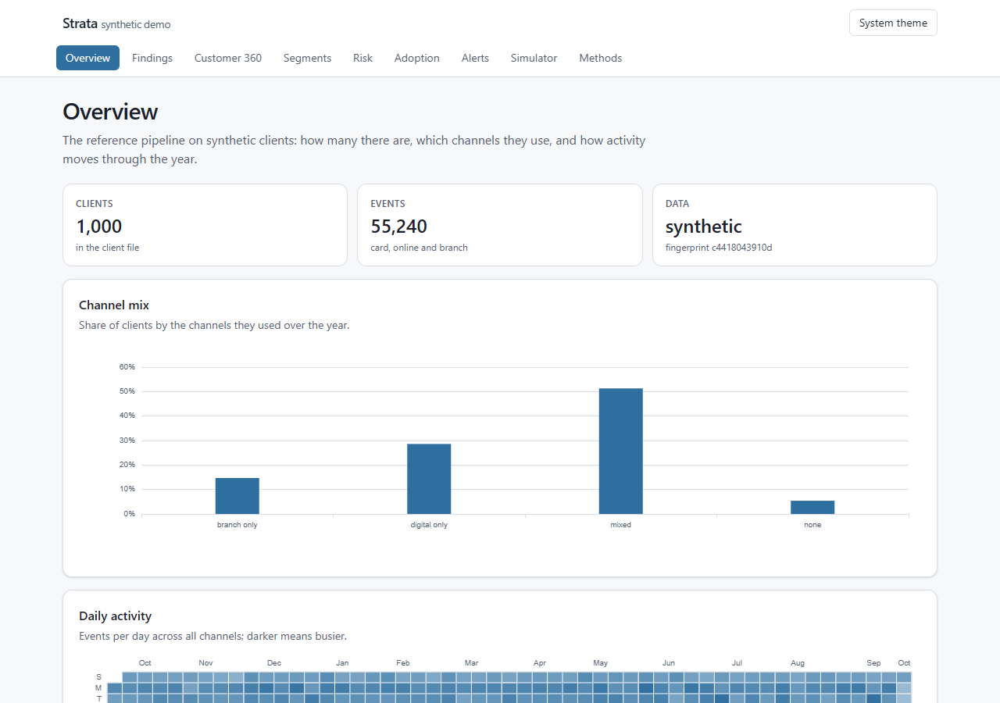
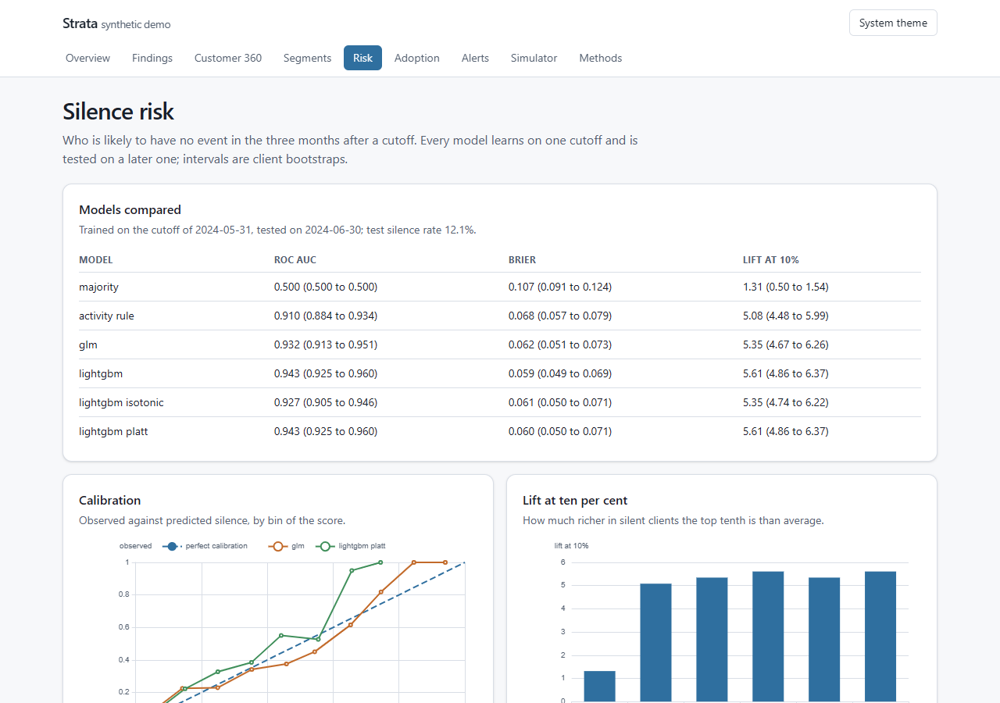
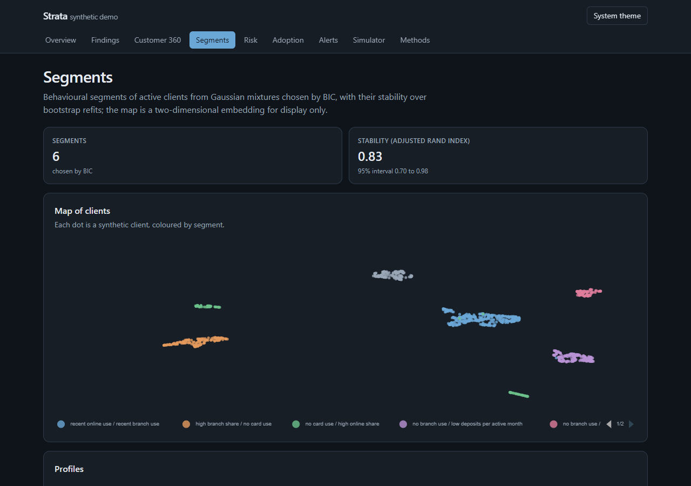
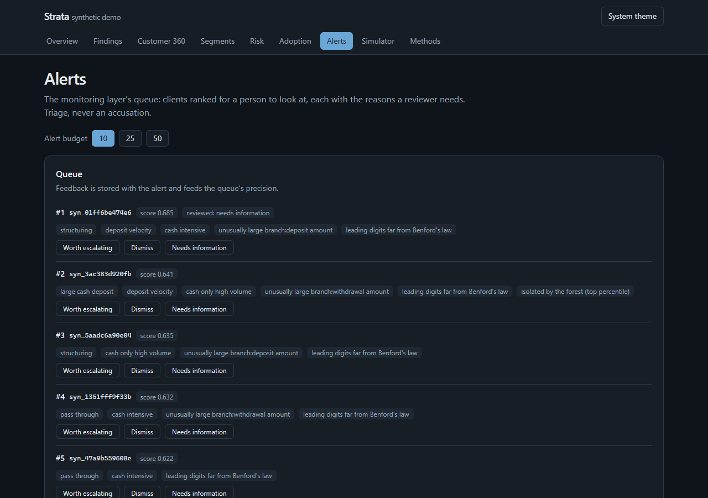

# Strata

**Strata** is a behaviour-analytics pipeline for multi-channel retail-banking event data: typed
contracts at the door, a tested warehouse, an evidence ledger in which no published number is typed
by hand, a robustness checker that re-stratifies every headline before anyone believes it, risk
models validated on later data, a monitoring queue for people to review, an API, a dashboard and a
daily DAG.

The pipeline is the product. Its reference instance is an anonymised, rolling-year extract of card,
online and branch activity of a sample of clients, provided by CIH Bank for an academic challenge;
it never enters this repository. A hand-specified synthetic generator is a first-class source, so
the whole system runs, and is tested, without the extract: `just demo` builds everything from a
clean clone on synthetic data.



## Why it exists

Strata replaces a hackathon script from 2024 (and its 2025 repackaging) whose results could not be
trusted: oversampling before the train/test split, a join that silently matched nothing, recency
measured from the day the script ran, a target that answered no business question, no time-based
validation and no uncertainty (the full list is [below](#the-legacy-code-and-its-bugs)). The rebuild
asks of every number the questions the script never asked: where did it come from, on how many
clients, with what interval, and does it survive holding the obvious confounders fixed?

## What the pipeline does

| Stage | What happens | Where |
|---|---|---|
| Contracts and ingest | Every file is parsed explicitly and checked against a typed contract; a manifest fingerprints the bytes; the warehouse is reconciled with the files. Any client-and-events source plugs in through a mapping file. | `strata/contracts/`, `strata/ingest/`, `mappings/` |
| Data quality | Exact repeats, zero and sub-unit amounts, vocabularies, plausibility and join coverage, reported as counts, never values. | `strata dq` |
| Warehouse | dbt on DuckDB: staging over code-map seeds, one event table for every channel, a dense client-month panel, monthly channel states, and marts for clients, silence features with time cuts, segments, monitoring and daily calendar series; every model and seed tested. | `dbt/` |
| Evidence ledger | Registered claims with client-bootstrap intervals, sample sizes, caveats and a data fingerprint. Documents are templates over the ledger, and CI fails on drift or on a number typed by hand. | `strata/ledger/` |
| Robustness checker | Each headline is recomputed inside strata of activity, age and tenure and labelled *holds*, *weakens* or *reverses*. | [method](docs/methods/robustness.md) |
| Analysis modules | Calendar effects (a negative-binomial regression and a PyMC twin with posterior predictive checks), STL seasonality, Lorenz, Gini and RFM scores per channel, Benford tests per category, and a Dirichlet-posterior Markov chain of channel states with a what-if simulator. | `strata analyse`, [methods](docs/methods/) |
| Risk models | Silence risk (baselines, a logistic GLM with odds ratios, LightGBM, isotonic and Platt calibration, SHAP), survival of the gaps between active days, online adoption, and behavioural segments; time-based backtests, a leakage test, client-bootstrap intervals on every metric, MLflow runs and generated model cards. | `strata train`, [model cards](docs/model_cards/) |
| Monitoring | Triage rules in YAML, an Isolation Forest, an empirical-Bayes model of each client's amounts and per-client Benford tests, combined into a ranked queue under an alert budget with reasons on every alert, and analyst feedback in a review store. Triage for people to review, never an accusation. | `strata anomaly`, [method](docs/methods/anomaly.md) |
| Serving | A FastAPI service over one zone's workspace, with Prometheus metrics by route and OpenAPI docs; Docker Compose with PostgreSQL and the MLflow UI. | `strata serve`, `docker-compose.yml` |
| Dashboard | Nine pages in React and TypeScript over the API, in light and dark themes and at phone width; every number fetched at run time, and the build fails if the bundle carries data. | `apps/dashboard/`, [decision record](docs/adr/0006-dashboard-stack.md) |
| Orchestration | The Airflow DAG `strata_daily`, every task one call of the `strata` CLI, with an evaluation gate between the models and the ledger. | `orchestration/airflow/`, [decision record](docs/adr/0005-airflow-orchestration.md) |
| Private twin | A differentially private copula of the client table with fidelity and membership-inference metrics, built and kept on the machine that holds the extract. | `strata --private synth-twin`, [decision record](docs/adr/0013-private-twin.md) |
| Reports | A private report of every claim, kept outside the repository, and a public demo on synthetic data. | `strata report` |

## Architecture



Two zones run the same code. The **public zone** reads the synthetic generator and writes inside
the repository's ignored workspace; the **private zone** reads the extract through `STRATA_DATA_DIR`
and writes only under `STRATA_PRIVATE_DIR`, outside the repository. Only allow-listed aggregates
cross from the second to the first. [`ARCHITECTURE.md`](ARCHITECTURE.md) has the full design and
[the decision records](docs/adr/README.md) the reasons behind it.

## How a source plugs in

Any extract with clients and dated channel events plugs in through a mapping file
(`mappings/<source>.yaml`, described in [`mappings/README.md`](mappings/README.md)): which file plays
which role, its encoding, delimiter, decimal mark and date format, which source column feeds which
canonical column, and how its codes translate into the vocabulary of the seeds. `strata ingest
--mapping <file>` loads it into three canonical tables, `raw.clients`, `raw.events` and
`raw.client_aggregates`, and dbt staging reads only those, so every mart, claim and model works
unchanged on a new source. Two mappings ship: the reference instance (read through its typed
contracts) and the synthetic generator. Two tests hold the layer to its promise: the reference
mapping reproduces the manifest, the data-quality report and every model's row count of the pipeline
as it was before mappings existed, and a property-based test maps a generated, deliberately
different schema onto the same marts ([ADR 0010](docs/adr/0010-canonical-layer.md)).

## How it is checked

- `just check` runs formatting and lint (`ruff`), strict typing (`mypy`), the test suite (`pytest`
  with `hypothesis`, coverage gate) on synthetic data, the privacy scan, the ledger check and the
  dashboard's checks. CI runs the same steps, builds the whole warehouse on synthetic data, runs
  the Compose stack with its smoke and accessibility tests, and runs the DAG with
  `airflow dags test`.
- Every dbt model and seed carries tests, including reconciliations against the ingest manifest and
  against the data-quality report.
- The robustness verdict rule was fixed before it met any data, and is tested on cases with a known
  answer (a textbook reversal, a uniform effect, an effect that vanishes inside strata).

## The dashboard, on synthetic data

| | |
|---|---|
|  |  |
|  |  |

The simulator at phone width: [screenshot](docs/images/dashboard-phone-simulator.png). The Findings
page is not pictured: it shows the allow-listed claims of the real extract, which belong in the
ledger and the documents rendered from it, not in images.

Outside Docker, `pnpm` installs the dashboard's packages through its content store, which it keeps
at the root of the drive when the repository is not on the drive of the user profile: that is
pnpm's normal behaviour, and the store is a cache shared by every pnpm project on the drive.

<!-- ledger:start -->
## What the reference instance shows

What the pipeline reports on its reference instance, rendered from the evidence ledger's
allow-listed claims (never typed by hand); see [the findings](docs/findings/index.md) for the
tables, methods, caveats and robustness checks behind each sentence.

- **Channels.** 51% of clients use both the branch and a
  digital channel, 29% only digital channels and
  15% only the branch
  (n = 1,000 clients; 2023-10-02 to 2024-10-02; real extract, allow-listed aggregate; data fingerprint 85887a44d747).
- **Age.** The branch-only share is
  6.9% in the <25 band and
  33% in the 65+ band, while the
  gap between the two gender codes is -1.5 percentage points.
  Robustness verdict: **holds**
  (n = 1,000 clients; 2023-10-02 to 2024-10-02; real extract, allow-listed aggregate; data fingerprint 85887a44d747).
- **The week.** On cards, the busiest day of the week carries
  1.10× the events of the quietest
  (n = 947 clients, 54,852 events; 2023-10-02 to 2024-10-02; real extract, allow-listed aggregate; data fingerprint 85887a44d747).
- **Prices.** Card purchase amounts show acceptable conformity with Benford's
  law; the share of leading nines differs from the law's expectation by
  +3.8 percentage points,
  the usual mark of psychological pricing (n = 515 clients, 14,496 events; 2023-10-02 to 2024-10-02; real extract, allow-listed aggregate; data fingerprint 85887a44d747).
- **Concentration.** The Gini coefficient of card spend is
  0.76 (n = 646 clients; 2023-10-02 to 2024-10-02; real extract, allow-listed aggregate; data fingerprint 85887a44d747).
- **Robustness at work.** Are branch-only clients more likely than digital-only clients to have no event in the quarter after the observation window, and does that survive holding activity fixed?
  Before stratification the silence rate is higher for branch-only clients than for digital-only clients. Holding activity level (tercile of events) fixed, the difference reverses its sign. Holding age band fixed, the difference keeps its sign. Holding tenure band fixed, the difference keeps its sign. Verdict: reverses. Mechanism: branch-only clients have fewer events in the observation window than digital-only clients; with few events a quarter without any is likely by chance, so the crude gap mostly measures activity, not channel.
  (verdict only, no value published; 2023-10-02 to 2024-10-02; real extract; data fingerprint 85887a44d747; the numbers stay private).
<!-- ledger:end -->

## Honesty and limitations

- **One sample, one year.** The reference instance is a sample of clients over a single rolling
  year; its size, period and fingerprint travel with every published number. Each month and holiday
  is seen once, so calendar effects cannot be told apart from trend, and the calendar findings say
  so. The outcome windows of consecutive cutoffs overlap, so a backtest's training and test labels
  share calendar weeks.
- **Assumed meanings.** The bank did not document its codes; gender and marital codes, aggregate
  flags, some branch labels and the holiday dates are used as inferred and tagged `assumed`
  ([data card](docs/data_card.md)); every claim that depends on one says so.
- **Silence is not attrition.** There is no account closing date, so the models predict a quarter
  without any event, which a dormant but loyal client also produces.
- **What is public, and what is not.** Only allow-listed aggregates of the real extract are
  published, each over enough clients; one finding is published as a verdict only, in words. Model
  metrics on real data stay private: the public registry and model cards describe models trained on
  synthetic data, which show that a method runs, never how well it predicts. Numbers in the
  synthetic demo are illustrative by construction.
- **Monitoring has no ground truth.** On the reference instance nobody labelled an alert; the queue
  is evaluated against planted scenarios on synthetic data and against pseudo-labels (two rule
  families agreeing), and it ranks cases for a person, never decides about one.
- **The private twin pays for privacy with fidelity.** On a sample of this size, a differentially
  private copula at a small budget keeps membership inference at chance but leaves little of the
  data's structure; the synthetic generator stays the source of every demo
  ([decision record](docs/adr/0013-private-twin.md)).
- **Not yet run in CI.** The workflow mirrors `just check`, the warehouse build, the dashboard
  checks, the Compose stack with its smoke and accessibility tests and the DAG test; until the
  branch is pushed, every one of them has been run locally only ([progress log](PROGRESS.md)).

## Privacy

The extract is reachable only through `STRATA_DATA_DIR`, set in a gitignored `.env.local` on the
machine that holds it (which may also hold that machine's Docker Compose port overrides);
everything derived from it goes to `STRATA_PRIVATE_DIR`, outside the repository. A pre-commit guard
blocks extract file names and headers, large CSVs, binary data formats, identifier-shaped tokens
(the shape is learnt from the extract when it is available) and non-allow-listed claims, without
ever echoing what it found. The dashboard's build fails if its bundle carries data, the API serves
one zone at a time, and the private twin refuses any destination inside the repository. See
[`PRIVACY.md`](PRIVACY.md).

## The legacy code and its bugs

The code Strata replaces is kept, frozen, in [`legacy/`](legacy/README.md), with every bug stated in
plain words so each can be checked against the source. The ones that invalidated its results:

- SMOTE oversampling ran on the whole dataset before the train/test split, so synthetic neighbours
  of test rows sat in the training set and the reported accuracy was inflated by construction.
- The join with the aggregate file matched no client (it describes a different sample), so the
  columns it was meant to fill were empty, and nothing counted the matches.
- Recency was measured from the day the script ran, not from the end of the extract.
- The target, each client's most frequent card transaction type, answered no business question,
  and missing labels became a spurious `'nan'` class.
- Client-level outcomes were evaluated on a random split, with no baseline and no interval.

The legacy README lists the others: misattributed sample output, mislabelled charts, a misnamed
feature, absence imputed as average, rare classes dropped silently, repeat rows counted as distinct,
every warning suppressed, and a sample that sampled nothing.

## Quick start

[`uv`](https://docs.astral.sh/uv/) and [`just`](https://just.systems/) are the tools to install by
hand (`uv tool install rust-just` provides `just`); Docker runs the stack and the DAG; Node with
`corepack` is needed only to work on the dashboard outside Docker.

```bash
just demo      # synthetic extract -> warehouse -> claims -> analysis -> models -> gate -> queue
               # -> report, then the stack in the background and a smoke test of every endpoint
just down      # stop the stack and remove its volumes
just check     # lint, types, tests with coverage, privacy scan, ledger check, dashboard checks
```

After `just demo`, the API answers on `http://localhost:8000` (documentation at `/docs`, metrics
at `/metrics`), the dashboard on `http://localhost:5173`, the MLflow UI on `http://localhost:5000`
and PostgreSQL on 5432. A host port that is already taken on a machine is moved in `.env.local`
with `STRATA_API_PORT`, `STRATA_DASHBOARD_PORT`, `STRATA_MLFLOW_PORT`, `STRATA_PG_PORT` or
`STRATA_AIRFLOW_PORT`; the recipes pass that file to Docker Compose when it exists.

| Recipe | What it runs |
|---|---|
| `just ledger` | synthetic extract, ingest, quality, dbt, every claim, the public demo report |
| `just analyse` | the analysis modules: claims, figures and the simulator's inputs |
| `just train` | the risk models, then the public registry and model cards (synthetic only) |
| `just anomaly` | the monitoring layer's ranked review queue |
| `just serve` | the API on the public workspace |
| `just up` | the whole stack in the foreground |
| `just dashboard`, `just dashboard-check`, `just dashboard-e2e` | the dashboard in development, its checks, its Playwright and axe smoke tests against the stack |
| `just dag-test` | `airflow dags test strata_daily` in the Airflow image, on synthetic data |
| `just private-*`, `just publish-claims` | the private zone, only on the machine that holds the extract (see `PRIVACY.md`) |

`uv run strata --help` lists every command.

## Repository layout

| Path | Contents |
|---|---|
| `strata/` | The Python package: configuration, CLI, contracts, ingest, synthetic data and the private twin, ledger, analysis, models, monitoring, review store, API, reports, privacy guard. |
| `dbt/` | The warehouse: seeds (code maps, bands, cutoffs, calendar), staging, intermediate models, marts and tests. |
| `mappings/` | Source mappings: the reference instance and the synthetic generator. |
| `apps/dashboard/` | The React and TypeScript dashboard, its tests, stories and smoke tests. |
| `orchestration/airflow/` | The DAG `strata_daily` and its plan. |
| `docker/`, `Dockerfile.*`, `docker-compose.yml` | Images, the nginx configuration and the smoke test. |
| `models/` | The public model registry (synthetic models only). |
| `docs/` | Decision records, methods, findings and the README section rendered from the ledger, the public claims, model cards, the data card and CV notes. |
| `tests/` | `pytest` and `hypothesis` suites; every test runs on synthetic data. |
| `legacy/` | The 2024 script and the 2025 package, frozen, with a list of their bugs. |

Further reading: [`ARCHITECTURE.md`](ARCHITECTURE.md), [`MILESTONES.md`](MILESTONES.md),
[`PROGRESS.md`](PROGRESS.md), [`PRIVACY.md`](PRIVACY.md), [`CHANGELOG.md`](CHANGELOG.md),
[decision records](docs/adr/README.md), [methods](docs/methods/), [findings](docs/findings/index.md),
[model cards](docs/model_cards/), [data card](docs/data_card.md) and [CV notes](docs/CV_NOTES.md).

## Licence and data

The code is released under the MIT licence ([`LICENSE`](LICENSE)). The bank extract is
confidential and is not, and will never be, part of this repository.
