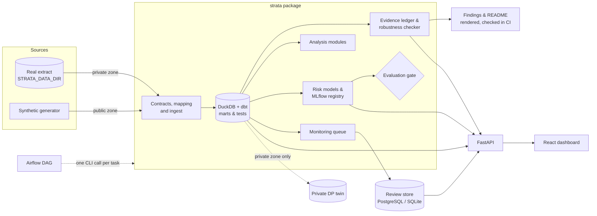

# Strata

**Strata** is a multi-channel retail-banking behaviour-analytics pipeline: typed ingest contracts,
a tested DuckDB/dbt warehouse, an evidence ledger where no published number is typed by hand, a
robustness checker that re-stratifies every headline, statistical and Bayesian analysis modules,
time-validated risk models, a triage monitoring queue, a FastAPI service, a React 19 dashboard, and
an Airflow daily DAG.

Its reference instance is a confidential, anonymised rolling-year extract from CIH Bank (never
committed to this repository). A deterministic synthetic generator is a first-class source, so the
entire stack runs and tests cleanly without the extract.

```bash
just setup     # .venv (Python 3.12 via uv) + pre-commit hooks
just demo      # synthetic extract -> warehouse -> models -> claims -> Compose stack + smoke test
just check     # ruff, mypy --strict, pytest, privacy scan, ledger check, dashboard checks
just down      # stop Compose stack and remove volumes
```

## Architecture



- **Ingest & Warehouse (`strata/contracts/`, `strata/ingest/`, `mappings/`, `dbt/`):** any
  client-and-events source plugs in via a YAML mapping (`mappings/README.md`), loads into
  canonical raw tables, runs sample-free data-quality checks (`strata dq`), and builds tested
  DuckDB/dbt staging, intermediate, and mart models.
- **Evidence Ledger & Analysis (`strata/ledger/`, `strata/analysis/`):** client-bootstrap claims
  with Simpson-paradox re-stratification (`holds` / `weakens` / `reverses`), frequentist & PyMC
  calendar models, STL seasonality, Lorenz/Gini/RFM concentration, Benford tests, and a
  Dirichlet-posterior Markov what-if simulator.
- **Risk Models & Monitoring (`strata/models/`, `strata/review/`):** time-validated silence risk
  (baselines, GLM, LightGBM, calibration, SHAP), gap survival, online adoption, GMM/KMeans
  segments, and a YAML-rules + Isolation Forest + empirical-Bayes triage queue with analyst
  feedback.
- **Serving, Dashboard & Orchestration (`strata/api/`, `apps/dashboard/`, `orchestration/`):**
  FastAPI with Prometheus metrics, a 9-page React + TypeScript dashboard (no data bundled, enforced
  at build time), Docker Compose (API, Dashboard, PostgreSQL, MLflow), and the `strata_daily`
  Airflow DAG.
- **Two Privacy Zones:** the **public zone** runs on synthetic data inside `.strata/`; the
  **private zone** (`strata --private …`) reads `STRATA_DATA_DIR` and writes only to
  `STRATA_PRIVATE_DIR` outside the repository. Only allow-listed aggregates cross into
  `docs/ledger/claims.public.json`. See [PRIVACY.md](PRIVACY.md).

<!-- ledger:start -->
## What the reference instance shows

What the pipeline reports on its reference instance, rendered from the evidence ledger's
allow-listed claims (never typed by hand); see [the findings](docs/findings/index.md) for the
tables, methods, caveats and robustness checks behind each sentence.

- **Channels.** 51% of clients use both the branch and a
  digital channel, 29% only digital channels and
  15% only the branch
  (n = 1,000 clients; 2023-10-02 to 2024-10-02; real extract, allow-listed aggregate; data fingerprint 85887a44d747).
- **Age.** The branch-only share is
  6.9% in the <25 band and
  33% in the 65+ band, while the
  gap between the two gender codes is -1.5 percentage points.
  Robustness verdict: **holds**
  (n = 1,000 clients; 2023-10-02 to 2024-10-02; real extract, allow-listed aggregate; data fingerprint 85887a44d747).
- **The week.** On cards, the busiest day of the week carries
  1.10× the events of the quietest
  (n = 947 clients, 54,852 events; 2023-10-02 to 2024-10-02; real extract, allow-listed aggregate; data fingerprint 85887a44d747).
- **Prices.** Card purchase amounts show acceptable conformity with Benford's
  law; the share of leading nines differs from the law's expectation by
  +3.8 percentage points,
  the usual mark of psychological pricing (n = 515 clients, 14,496 events; 2023-10-02 to 2024-10-02; real extract, allow-listed aggregate; data fingerprint 85887a44d747).
- **Concentration.** The Gini coefficient of card spend is
  0.76 (n = 646 clients; 2023-10-02 to 2024-10-02; real extract, allow-listed aggregate; data fingerprint 85887a44d747).
- **Robustness at work.** Are branch-only clients more likely than digital-only clients to have no event in the quarter after the observation window, and does that survive holding activity fixed?
  Before stratification the silence rate is higher for branch-only clients than for digital-only clients. Holding activity level (tercile of events) fixed, the difference reverses its sign. Holding age band fixed, the difference keeps its sign. Holding tenure band fixed, the difference keeps its sign. Verdict: reverses. Mechanism: branch-only clients have fewer events in the observation window than digital-only clients; with few events a quarter without any is likely by chance, so the crude gap mostly measures activity, not channel.
  (verdict only, no value published; 2023-10-02 to 2024-10-02; real extract; data fingerprint 85887a44d747; the numbers stay private).
<!-- ledger:end -->

## Quick start & recipes

Requires [uv](https://docs.astral.sh/uv/), [just](https://just.systems/), Docker (for the stack and
Airflow DAG), and Node 20+ with `corepack` (only for developing the dashboard outside Docker).

After `just demo`: API `http://localhost:8000` (`/docs`, `/metrics`), Dashboard
`http://localhost:5173`, MLflow `http://localhost:5000`, PostgreSQL `5432`. Override ports in
gitignored `.env.local` via `STRATA_{API,DASHBOARD,MLFLOW,PG,AIRFLOW}_PORT`.

- **Pipeline stages (synthetic):** `just ledger`, `just analyse`, `just train`, `just anomaly`,
  `just serve`, `just up`, `just dag-test` (`uv run strata --help` lists all CLI commands).
- **Dashboard:** `just dashboard`, `just dashboard-check`, `just dashboard-e2e`.
- **Private zone (local extract only):** `just private-ingest`, `just private-dbt`,
  `just private-report`, `just private-analyse`, `just private-train`, `just publish-claims`.

## Repository layout

```
strata/            Core package (contracts, ingest, synthetic/twin, ledger, analysis, models, API)
dbt/               DuckDB warehouse (code-map seeds, staging, intermediate, marts, dbt tests)
mappings/          Source-mapping YAMLs (reference extract and synthetic generator)
apps/dashboard/    React 19 + TypeScript dashboard, Vitest, Storybook, Playwright E2E
orchestration/     Airflow DAG (`strata_daily`)
docker/            Entrypoint, nginx proxy, and Compose smoke test
models/            Public synthetic model registry
docs/              Findings, methods, model cards, data card, public ledger JSON, ADRs
tests/             Pytest + Hypothesis suite (synthetic data only)
legacy/            Frozen 2024 script and 2025 package with documented defects
```

## Limitations & further reading

- **One rolling year & inferred codes:** calendar effects cannot be separated from trend, backtest
  outcome windows overlap, silence (no events in a quarter) is not account closure, and
  undocumented bank codes are tagged `assumed` ([data card](docs/data_card.md)).
- **Public vs. private outputs:** public model cards and the synthetic demo show that the pipeline
  runs, not real-world accuracy; monitoring has no labelled ground truth and serves triage only.
- **Docs:** [PRIVACY.md](PRIVACY.md) · [Findings](docs/findings/index.md) ·
  [Methods](docs/methods/) · [Model cards](docs/model_cards/) ·
  [Data card](docs/data_card.md) · [ADRs](docs/adr/README.md) ·
  [Legacy code & bugs](legacy/README.md).

## Licence

Released under the **MIT Licence** ([LICENSE](LICENSE)). The confidential bank extract is never
included in this repository.
