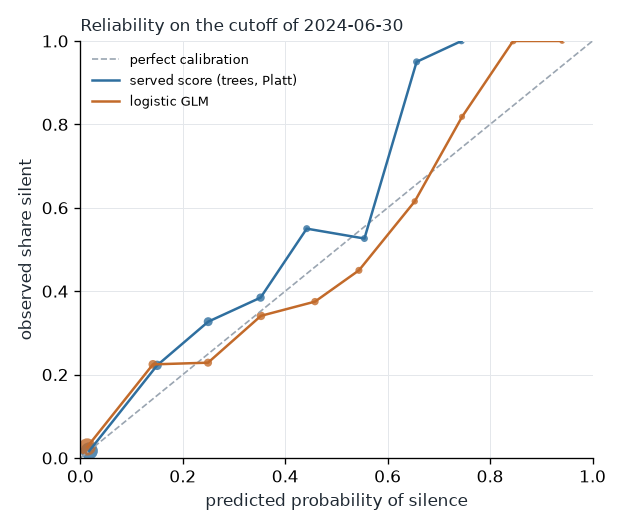

<!-- Generated by `strata promote` from models/registry.json (silence). -->

# Model card: Silence risk in the next three months

- Version `0.1.0+c4418043.20261019030828`, trained 2026-10-19, effort full.
- Data: synthetic data from the public generator (the numbers say nothing about any bank); fingerprint `c4418043910d`.
- MLflow run: kept in the local workspace's store, not published.

Intended use: Triage and prioritisation by people who review each case: a ranking of clients to look at first, never an automatic decision about a client.

## What it predicts

Whether a client with at least one event before a cutoff has no event at all in the three months after it (silence). Features use events up to the cutoff only; a test proves that changing anything after the cutoff leaves them unchanged.

## Validation

Trained on the cutoff of 2024-05-31 (935 clients, silence rate 10.6%) and tested on the later cutoff of 2024-06-30 (939 clients, silence rate 12.1%). Hyperparameters were tuned on the earliest cutoff only. Intervals: client bootstrap, 95%.

| Model | ROC AUC | Average precision | Brier | Calibration error | Lift at 10% |
|---|---|---|---|---|---|
| majority | 0.500 (0.500 to 0.500) | 0.121 (0.101 to 0.143) | 0.107 (0.091 to 0.124) | 0.016 (0.001 to 0.037) | 1.31 (0.50 to 1.54) |
| activity_rule | 0.910 (0.884 to 0.934) | 0.524 (0.442 to 0.612) | 0.068 (0.057 to 0.079) | 0.012 (0.006 to 0.030) | 5.08 (4.48 to 5.99) |
| glm | 0.932 (0.913 to 0.951) | 0.710 (0.632 to 0.781) | 0.062 (0.051 to 0.073) | 0.025 (0.018 to 0.045) | 5.35 (4.67 to 6.26) |
| lightgbm | 0.943 (0.925 to 0.960) | 0.735 (0.662 to 0.804) | 0.059 (0.049 to 0.069) | 0.017 (0.015 to 0.037) | 5.61 (4.86 to 6.37) |
| lightgbm_isotonic | 0.927 (0.905 to 0.946) | 0.659 (0.584 to 0.734) | 0.061 (0.050 to 0.071) | 0.026 (0.014 to 0.042) | 5.35 (4.74 to 6.22) |
| lightgbm_platt | 0.943 (0.925 to 0.960) | 0.735 (0.662 to 0.804) | 0.060 (0.050 to 0.071) | 0.024 (0.019 to 0.044) | 5.61 (4.86 to 6.37) |

ROC AUC of the trees minus the GLM, paired on the same clients: 0.011 (0.003 to 0.020).

Every backtest (the served score: trees with Platt scaling):

| Train cutoff | Test cutoff | ROC AUC | Lift at 10% |
|---|---|---|---|
| 2024-04-30 | 2024-05-31 | 0.928 (0.902 to 0.951) | 5.83 (5.06 to 6.66) |
| 2024-05-31 | 2024-06-30 | 0.943 (0.925 to 0.960) | 5.61 (4.86 to 6.37) |

## What drives the score

Mean absolute SHAP value (log-odds):

| Feature | Mean absolute SHAP |
|---|---|
| n_events_90d | 0.509 |
| active_months | 0.316 |
| n_events_30d | 0.282 |
| recency_days | 0.279 |
| n_events | 0.198 |
| branch_credit | 0.104 |
| card_spend | 0.084 |
| active_span_days | 0.076 |

The three largest drivers of every backtest (mean absolute SHAP):

| Train cutoff | Test cutoff | Drivers |
|---|---|---|
| 2024-04-30 | 2024-05-31 | recency_days 0.447, active_months 0.446, n_events_30d 0.245 |
| 2024-05-31 | 2024-06-30 | n_events_90d 0.509, active_months 0.316, n_events_30d 0.282 |

Odds ratios of the GLM (continuous features per standard deviation):

| Feature | Odds ratio (95% CI) |
|---|---|
| active_months | 0.16 (0.06 to 0.43) |
| n_branch | 3.99 (1.52 to 10.48) |
| n_card | 2.06 (0.53 to 8.04) |
| n_events | 1.92 (0.37 to 10.07) |
| n_events_30d | 0.23 (0.11 to 0.48) |
| n_events_90d | 0.22 (0.08 to 0.56) |
| n_online | 4.79 (0.83 to 27.54) |
| profile_digital_only | 10.14 (1.94 to 53.02) |

## Training data

The public card describes a model trained on the synthetic generator's extract, read through the synthetic mapping into the same marts as the reference instance. On the machine that holds the extract the same code trains on the real marts in the private zone; that model, its card and its scores stay under `STRATA_PRIVATE_DIR`, and its metrics are not published.

## Ethical considerations

The score ranks clients for a person's attention, such as a call or a reminder; it must never trigger an action on its own, set a price or refuse a service. A quiet client is not a departing one, so any outreach it prompts should be easy for the client to decline.

## Limitations

- One year of data: the outcome windows of consecutive cutoffs overlap, so a backtest's training labels share calendar weeks with its test labels, and seasonal effects cannot be told apart from trend.
- Code meanings marked `assumed` in the seeds (see `docs/data_card.md`) are used as stated.
- Synthetic results show that the pipeline works; they are not evidence about clients.

## Reproduce and refresh

`just dbt`, then `uv run strata train silence` (`--quick` for the effort of tests and demos; `uv run strata --private train silence` on the machine that holds the extract). The daily DAG retrains it, and its evaluation gate (`strata evaluate`) stops the run before the ledger if the model was trained on other data or ranks no better than chance.
